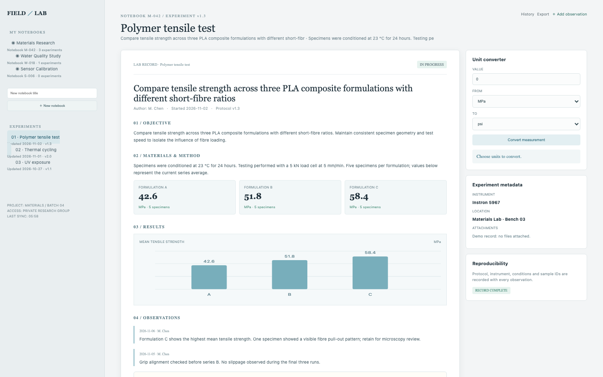

# Lab Notebook

A reproducible experiment record: notebooks, objectives and methods, append-only observations, measurements with units, a chart, a data table and CSV export.

## Run it

```sh
npm install
npm start
```

Open the address it prints. `npm test` runs the tests (node:test; no network, no key).

## What to ask the chat next

- Add a measurement for sample C-06 and watch the series average change.
- Append an observation to the tensile test and open the CSV export.
- Convert 1 bar to psi in the unit converter.

## Screenshot


